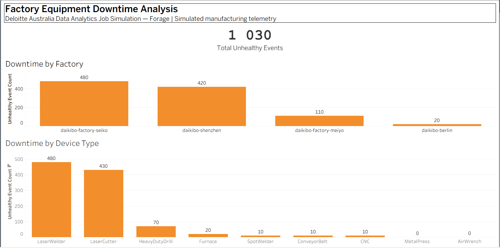

# Factory Equipment Downtime Analysis

A data analytics and visualization project examining equipment health across multiple manufacturing facilities using simulated telemetry data.

This project was completed as part of the **Deloitte Australia Data Analytics Job Simulation on Forage** and later refined as a portfolio project to improve the dashboard's clarity, presentation and usability.

> **Disclaimer:** This was a virtual job simulation completed through Forage. It does not represent employment at Deloitte, and the data used in the simulation is not presented as real Deloitte client data.

## Dashboard

## Project Objective

The analysis focused on understanding where unhealthy equipment events were concentrated across the simulated manufacturing environment.

The dashboard was designed to answer two main questions:

1. Which factory recorded the highest number of unhealthy equipment events?
2. Which device types contributed most to those events?

## Tools Used

- Microsoft Excel
- Tableau
- Data analysis
- Data visualization
- Dashboard design

## Dashboard Metrics

The final analysis identified **1,030 total unhealthy events** across the simulated manufacturing data.

### Unhealthy Events by Factory

| Factory | Unhealthy Events |
|---|---:|
| daikibo-factory-seiko | 480 |
| daikibo-shenzhen | 420 |
| daikibo-factory-meiyo | 110 |
| daikibo-berlin | 20 |

### Unhealthy Events by Device Type

| Device Type | Unhealthy Events |
|---|---:|
| LaserWelder | 480 |
| LaserCutter | 430 |
| HeavyDutyDrill | 70 |
| Furnace | 20 |
| SpotWelder | 10 |
| ConveyorBelt | 10 |
| CNC | 10 |
| MetalPress | 0 |
| AirWrench | 0 |

## Key Findings

- **Daikibo Factory Seiko** recorded the highest number of unhealthy events, with **480**.
- **Daikibo Shenzhen** followed with **420** unhealthy events.
- Together, Seiko and Shenzhen accounted for approximately **87% of all unhealthy events** in the dataset.
- **LaserWelder** recorded **480** unhealthy events, making it the device type with the highest count.
- **LaserCutter** followed with **430**.
- LaserWelder and LaserCutter together accounted for approximately **88% of all unhealthy events**, indicating that unhealthy-event activity was heavily concentrated in these two device categories.
- MetalPress and AirWrench recorded no unhealthy events in the analysed data.

## Dashboard Development

The original simulation involved analysing manufacturing telemetry and producing a Tableau dashboard.

For the portfolio version, I refined the dashboard by:

- adding a clear dashboard title and simulation context;
- creating a KPI showing the total number of unhealthy events;
- improving chart titles and axis descriptions;
- sorting device types by unhealthy-event count;
- improving tooltips for easier interpretation;
- improving dashboard spacing and visual hierarchy;
- ensuring the dashboard clearly distinguishes factory-level and device-level analysis.

## What I Practised

This project helped me practise:

- interpreting operational data;
- summarising data for business users;
- building Tableau bar charts;
- creating and formatting KPI cards;
- sorting and comparing categorical results;
- creating clearer dashboard tooltips;
- presenting key findings visually;
- refining an existing analytical deliverable based on presentation and usability considerations.

## Project Context

This project originated from the **Deloitte Australia Data Analytics Job Simulation on Forage**.

The simulation provided an opportunity to practise analysing simulated manufacturing information using Excel and Tableau.

The portfolio version shown here includes additional presentation refinements completed after the simulation.

## Author

**Azile Gomomo**  
BCom Information Systems Student — University of Johannesburg

- LinkedIn: https://www.linkedin.com/in/azile-gomomo-520b33366
- GitHub: https://github.com/Azile-cell
- Portfolio: https://azile-cell.github.io/Azile-portfolio/
